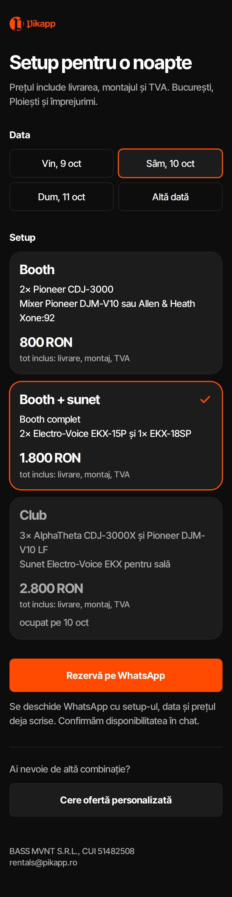

# Review: rezerva-setup v1

Run with `design-review` on `screens/rezerva-setup/v1.html`, 4 Oct 2026. Contrast and sizes were measured on the rendered page (headless Chromium, 390px wide), not estimated.



```
design-review: screens/rezerva-setup/v1.html
FAIL C1 one filled button | 2 found: "Rezervă pe WhatsApp" (signal #FF4A00 fill) and "Cere ofertă personalizată" (surface #1C1C1C fill, line border) | principles 2 and 5 | smallest fix: make "Cere ofertă personalizată" a text button (specs, Text button)
PASS C2 colours trace to specs | 6 colours in the file, all specs tokens: #0D0D0D #1C1C1C #262626 #FFFFFF #ABABAB #FF4A00
FAIL C3 contrast | "Rezervă pe WhatsApp": #FFFFFF on #FF4A00 = 3.37:1 at 16px, needs 4.5:1 | principles 7; specs contrast table marks text on signal as not allowed below 24px | smallest fix: label in ink #0D0D0D (5.77:1)
FAIL C4 type sizes | "tot inclus: livrare, montaj, TVA" is 14px (meta) on all three setup cards; meta is for the legal line only, and these are price conditions | specs, Type (meta); principles 3 | smallest fix: conditions at body 16px in text-muted
PASS C5 price integrity | every setup shows its number (800 RON, 1.800 RON, 2.800 RON), no "de la", no extras on another screen, conditions on the same card under the price
PASS C6 two tracks | no form or contact field before the price; personalizată route present below the action, outside the setup cards
PASS C7 copy | sentence case throughout; button starts with a verb ("Rezervă pe WhatsApp"); model names (CDJ-3000, DJM-V10, Xone:92, EKX-15P, EKX-18SP, CDJ-3000X, DJM-V10 LF); no banned words, no em dash; "ocupat pe 10 oct" is a state, not urgency
PASS C8 assets and targets | Inter Tight and pikapp-lockup-orange-trimmed.png are in materials/LICENSES.md; smallest tap target 48px (date chips)
Result: 3 FAIL, 5 PASS
```

## Note

Every value in v1 traces to `specs` (C2 passes), and it still fails three checks. The specs say what is correct; the principles say why. All three fails are habits carried over from the live pikapp.ro: white labels on coloured buttons, conditions in small grey text, and more than one filled button.
