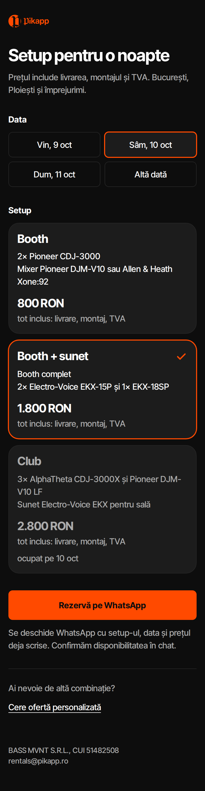

# Review: rezerva-setup v2

Run with `design-review` on `screens/rezerva-setup/v2.html`, 4 Oct 2026, after fixing the three fails from v1. Contrast and sizes measured on the rendered page (headless Chromium, 390px wide).



```
design-review: screens/rezerva-setup/v2.html
PASS C1 one filled button | 1 found: "Rezervă pe WhatsApp"; "Cere ofertă personalizată" is now a text button (no fill, underlined, 48px tall)
PASS C2 colours trace to specs | 6 colours in the file, all specs tokens: #0D0D0D #1C1C1C #262626 #FFFFFF #ABABAB #FF4A00
PASS C3 contrast | button label #0D0D0D on #FF4A00 = 5.77:1; lowest text pair is text-muted #ABABAB on surface #1C1C1C = 7.42:1
PASS C4 type sizes | sizes used: 14, 16, 22, 32 (all in specs); price conditions now 16px; 14px only on the footer legal line and email
PASS C5 price integrity | every setup shows its number with "tot inclus: livrare, montaj, TVA" on the same card, at body size
PASS C6 two tracks | standard track: date + setup only, no fields; personalizată is a separate text link to pikapp.ro/#contact
PASS C7 copy | re-checked: sentence case, verb-first buttons, model names, no banned words, no em dash, no urgency
PASS C8 assets and targets | font and logo listed in LICENSES.md; smallest tap target 48px
Result: 0 FAIL, 8 PASS
```

## What changed from v1

| Check | v1 | v2 |
|---|---|---|
| C1 | "Cere ofertă personalizată" as a second filled button | text button |
| C3 | white label on orange, 3.37:1 | ink label on orange, 5.77:1 |
| C4 | conditions at 14px | conditions at 16px |

## Line added to a skill

The v1 label was a real token (`text`) on a real token (`signal`), so the value trace passed while the pair itself is forbidden in the `specs` contrast table. Fixed in the file, not only in the answer: `generate-design` step 5 now requires every label on a filled background to be listed with its contrast ratio from that table.
